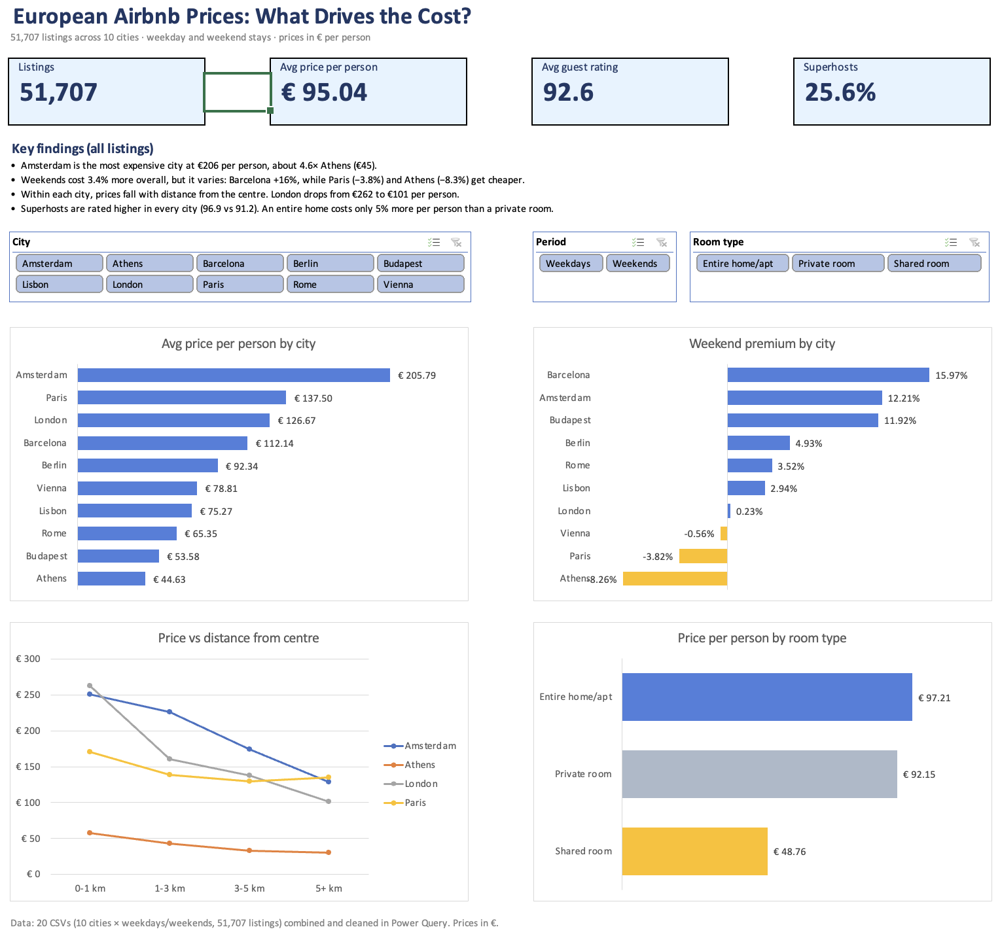

# European Airbnb Prices: What Drives the Cost?

An Excel analysis of **51,707 Airbnb listings across 10 European cities**, looking at how price changes with city, day of the week, distance from the centre, host status and room type.

**Tools:** Microsoft Excel: Power Query, PivotTables, PivotCharts, slicers, GETPIVOTDATA, conditional formatting

---

## The questions

1. Which cities are the cheapest and most expensive per person?
2. Do weekends cost more than weekdays?
3. Does staying closer to the city centre cost more?
4. Do superhosts get better ratings, and do they charge more?
5. Is renting an entire home worth it compared with a private room?

## Key findings

- **Amsterdam is the most expensive city**, at €205.79 per person on average. That's about **4.6× Athens** (€44.63), the cheapest.
- **Weekends cost 3.4% more overall, but it depends on the city.** Barcelona is **+16%**, Amsterdam +12% and Budapest +12%, while **Paris (−3.8%), Athens (−8.3%) and Vienna (−0.6%) are cheaper on weekends**.
- **Prices fall with distance from the centre, but only inside each city.** London drops from €262 per person within 1 km to €101 beyond 5 km. Across all cities combined the effect disappears (€91–€102 in every distance band), because big, expensive cities like London have many listings far from the centre. The overall average hides the real pattern.
- **Superhosts are rated higher in every city** (96.9 vs 91.2 out of 100). They look cheaper overall (€86 vs €98), but that's because superhosts are concentrated in cheaper cities such as Athens and Budapest. Within most cities they charge slightly more.
- **An entire home costs 58% more in total than a private room, but only 5% more per person** (€97 vs €92), because entire homes fit more guests (3.7 vs 2.3).

## How I built it

**1. Combine the data.** The data came as 20 CSV files (10 cities × weekdays/weekends). In Power Query I imported each file, added `City` and `Period` columns, and appended all 20 into one table of 51,707 rows.

**2. Clean and model.** Still in Power Query, I:
- removed the unnamed index column
- set the data types (decimal, whole number, true/false, text)
- added `price_per_person` = `realSum` ÷ `person_capacity`
- added `Distance_band` (0-1 km, 1-3 km, 3-5 km, 5+ km) using a conditional column

**3. Analyse.** I built one PivotTable per question:
- weekend premium with *Show Values As → % Difference From*
- a heatmap of city × distance band with conditional formatting
- room-type comparisons using *% of Grand Total*

**4. Dashboard.** The dashboard has:
- KPI cards linked to a helper PivotTable with `GETPIVOTDATA`
- four PivotCharts
- slicers for City, Period and Room type, connected to every relevant PivotTable

The Period slicer is deliberately not connected to the weekend premium chart, because that comparison needs both periods.

## Workbook contents

| Sheet | What's in it |
|---|---|
| `Dashboard` | KPIs, slicers, four charts and key findings |
| `Europe_Airbnb_All` | The combined, cleaned data (output of Power Query) |
| `Q1_price_by_city` … `Q5_Room_Types` | One PivotTable per question |
| `KPI_Calc` | Helper PivotTables that feed the KPI cards |

The `data/` folder holds the 20 original CSV files. To refresh the Power Query steps yourself, put them in `C:\Airbnb_Europe\data\` or edit each query's Source step to point to your folder. Opening the workbook doesn't need a refresh.

## Notes and limitations

- **What "price per person" means.** In the source data, `realSum` is the total price for **2 guests and 2 nights**, in euros. `price_per_person` divides it by the listing's capacity, so it's the cost per guest **if the listing were full**. It's a way to compare listings of different sizes fairly, not the exact amount each guest would pay.
- **Small sample for shared rooms.** There are only 366 shared-room listings (0.7%), so results for them are less reliable.
- **One point in time.** This is a single snapshot of prices, not a trend over time.

## Data source

Gyódi, K., & Nawaro, Ł. (2021). *Determinants of Airbnb prices in European cities: A spatial econometrics approach* (Supplementary Material) [Dataset]. Zenodo. https://doi.org/10.5281/zenodo.4446043. Licensed under [CC BY 4.0](https://creativecommons.org/licenses/by/4.0/).

---

Built by Darell Garay
